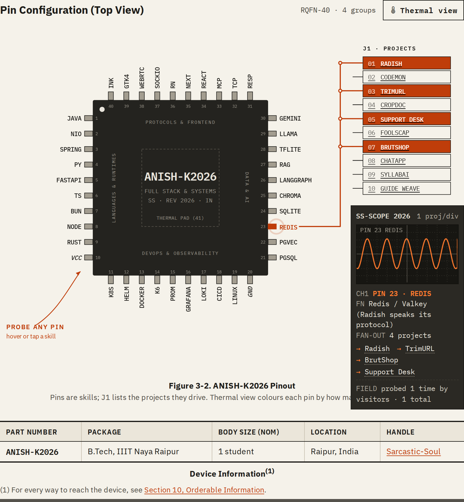
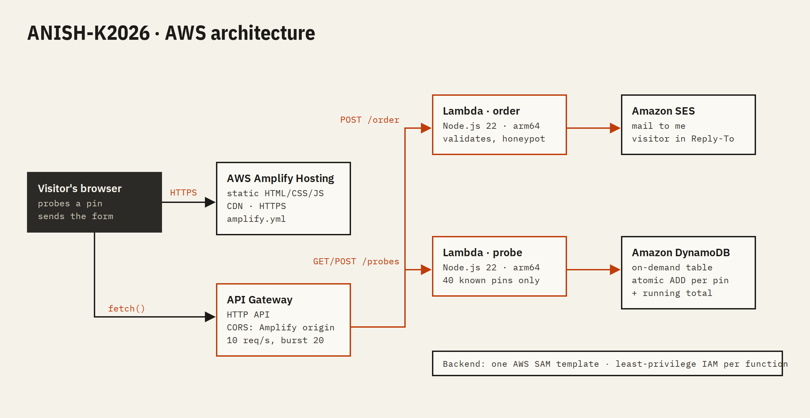

# ANISH-K2026 datasheet

My portfolio, written as the data sheet for a chip that does not exist. The ANISH-K2026 is
"made" by Sarcastic Semiconductor, a joke company. The developer, the projects, the skills and
every measured number in it are real.

**Live:** https://main.dqlrsim6jsntx.amplifyapp.com



Built for the AWS Student Builder Challenge: Build Your Tech Superpower.

## The interactive feature: probe a pin

The pinout on page 1 is a 40-pin chip. Every pin is one skill. Hover, tap or press Enter on a pin
and:

- a copper trace is drawn from the pin to the J1 connector, lighting up every project that uses
  that skill;
- the SS-SCOPE oscilloscope shows a live waveform for the pin (square wave for languages, sawtooth
  for DevOps, sine for data and AI, the pin's name in serial bits for protocols);
- the scope readout lists the projects, with links, and a **field log**: how many times visitors
  have probed this pin, stored in DynamoDB.

The hint is always on screen: "PROBE ANY PIN" with an arrow on desktop, "▲ TAP ANY PIN TO PROBE IT"
on phones. Thermal view recolours the pins by how many projects use each skill.

Smaller things in the same spirit: block diagrams you can send a request through, a benchmark
chart you can re-run, a timing diagram for my work history, and "printed" grayscale figures that
turn to colour when touched.

## Architecture



```
Browser ── AWS Amplify Hosting (static HTML/CSS/JS, CDN)
   │
   └── Amazon API Gateway (HTTP API, CORS locked to the Amplify domain, throttled)
         ├── POST /order   ── AWS Lambda (order.mjs)  ── Amazon SES ── my inbox
         ├── GET  /probes  ── AWS Lambda (probe.mjs) ── Amazon DynamoDB
         └── POST /probes  ── AWS Lambda (probe.mjs) ── Amazon DynamoDB
```

| Service | What it does here |
| --- | --- |
| AWS Amplify Hosting | Serves the site over HTTPS from a CDN, builds from this repo with `amplify.yml` |
| AWS Lambda (Node.js 22, arm64) | `order` sends the contact form; `probe` counts pin probes |
| Amazon API Gateway (HTTP API) | Public endpoints, CORS, rate limit of 10 req/s (burst 20) |
| Amazon SES | Delivers "Request samples" form messages, with the visitor in Reply-To |
| Amazon DynamoDB | One on-demand table, one item per pin with an atomic counter |
| AWS SAM / CloudFormation | The whole backend is one template: `backend/template.yaml` |
| IAM | Each function gets only what it needs: `ses:SendEmail` on one identity, CRUD on one table |

## Layout

```
index.html        the four data sheet pages
css/styles.css    all styles
js/data.js        pins, projects, roles: the content
js/app.js         pinout, scope, field log, charts, timing diagram, form
assets/           project screenshots (WebP)
backend/          SAM template and the two Lambda functions
amplify.yml       Amplify build spec (copies the site into dist/)
```

No framework and no build step for the site.

## Run it locally

```
python3 -m http.server 8080
```

Open http://localhost:8080. The API allows `http://localhost:8080` as a CORS origin, so the field
log and form work locally too.

## Deploy the backend

Needs the AWS CLI and AWS SAM CLI, and a verified SES identity for `MailAddress`.

```
cd backend
sam build
sam deploy            # settings are in samconfig.toml
```

Copy the `ApiUrl` output into `API_BASE` at the top of `js/app.js`. Leave `API_BASE` empty and the
form falls back to `mailto:` and the field log hides itself.

## Contact

anishisbusy@gmail.com · [GitHub](https://github.com/Sarcastic-Soul) ·
[LinkedIn](https://linkedin.com/in/anish-kumar-852397290/)
